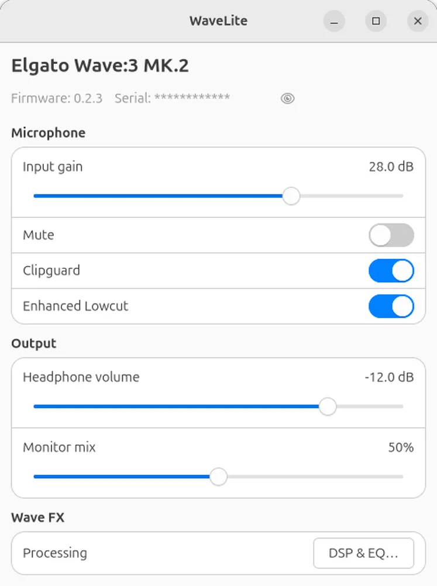
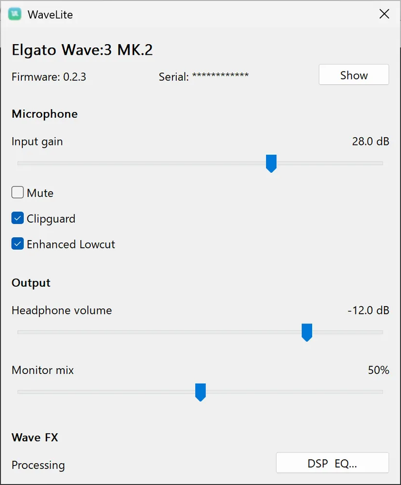
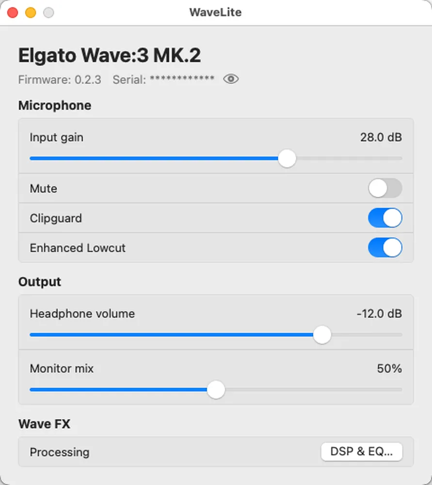

# WaveLite

  

WaveLite is a lightweight GUI and CLI for controlling Elgato Wave microphones on Linux, Windows, and macOS. It controls the microphone's hardware while audio capture and headphone playback continue through the standard USB-audio driver. No administrator access is needed on Windows or macOS.

**Windows GUI:** approximately **1 MB** on disk and **14 MB RAM at idle**.

## Screenshots

| GTK4 (Linux) | Windows | macOS |
| :---: | :---: | :---: |
|  |  |  |

## Hardware support

| Microphone | Gain & mute | Headphones & mix | Clipguard | Enhanced Lowcut | DSP & EQ |
| --- | --- | --- | --- | --- | --- |
| Wave:1 | Yes | Yes | Yes | Yes | — |
| Wave:3 MK.1 | Yes | Yes | Yes | Yes | — |
| Wave:3 MK.2 | Yes | Yes | Clipguard 2.0 | Yes | Expander, compressor, voice tune, four-band EQ |

## Download

Download the latest release for your platform:

| Platform | Download |
| --- | --- |
| Linux | [x86_64 AppImage](https://github.com/pH200/wavelite/releases/latest) |
| Windows | [x86_64 and ARM64 MSI, GUI ZIP, or CLI ZIP](https://github.com/pH200/wavelite/releases/latest) |
| macOS | [Universal GUI or CLI ZIP](https://github.com/pH200/wavelite/releases/latest) |

### Use the Linux AppImage

Open the AppImage to start the GUI. For desktop integration and automatic updates, use [Gear Lever](https://github.com/mijorus/gearlever). Each release includes the required `.AppImage.zsync` companion file.

## CLI

See the [CLI documentation](docs/cli.md) for hardware controls, MK.2 DSP/EQ commands, and configuration snapshots.

## Contribution

Due to limited resources for security review, pull requests are not currently accepted. Please open an issue to submit a request.

## Disclaimer

WaveLite is an unofficial, independent project and is not affiliated with, endorsed by, or sponsored by Elgato or Corsair.

Use this project at your own risk. The authors and contributors accept no responsibility or liability for any loss, damage, or device malfunction arising from its use.

This project was developed with assistance from agentic coding tools.
